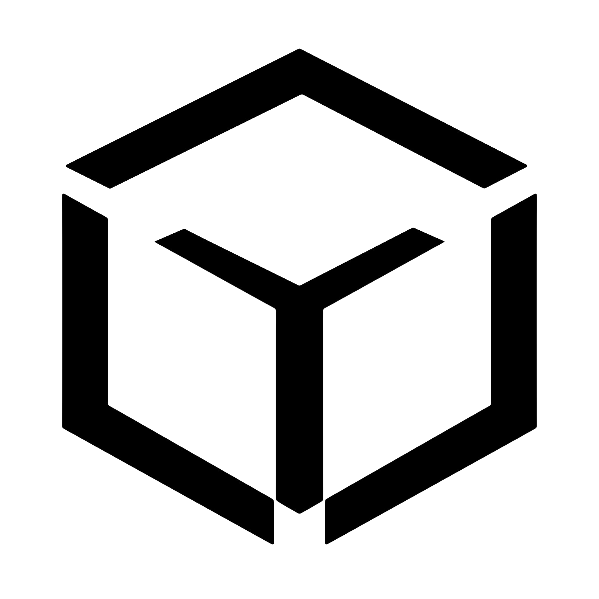

<div align="center">

<picture>
  <source media="(prefers-color-scheme: dark)" srcset="public/logo-white.png">
  
</picture>

# Cubixso.ai — Website

**Generative AI for the autonomous enterprise.**

</div>

Marketing site and design system for **Cubixso Solutions Private Limited** — an AI‑native product studio building agentic systems, LLMOps and RAG platforms.

Next.js 16 (App Router) · React 19 · Tailwind CSS v4 · TypeScript · Deployed on Vercel.

---

## Table of contents

- [Live URLs](#live-urls)
- [Quick start](#quick-start)
- [Environment variables](#environment-variables)
- [Route map](#route-map)
- [Repository layout](#repository-layout)
- [**Design language**](#design-language)
  - [Brand](#brand)
  - [Principles](#principles)
  - [Colour](#colour)
  - [Typography](#typography)
  - [Layout & spacing](#layout--spacing)
  - [Liquid Glass — the elevation system](#liquid-glass--the-elevation-system)
  - [Motion](#motion)
  - [3D & WebGL](#3d--webgl)
  - [Iconography](#iconography)
  - [Theming](#theming)
  - [Accessibility](#accessibility)
- [Content model](#content-model)
- [Forms and anti‑spam](#forms-and-anti-spam)
- [SEO](#seo)
- [Performance rules](#performance-rules)
- [Gotchas](#gotchas-hard-won)
- [Deployment](#deployment)

---

## Live URLs

| URL | What it serves | Where it lives |
|---|---|---|
| `app.cubixso.com` | **This repository** — the full site. Canonical domain. | here |
| `cubixso.com` / `www.cubixso.com` | Launch splash page only | **separate project** (`cubixso-ai-loading`, a small Vite app) |

The apex forwards to `www` at the registrar, and `www` serves the splash, whose Launch button opens `app.cubixso.com`. The GitHub repo's About panel lists both domains; only `app.` serves this codebase. `SITE_URL` in `src/lib/seo.ts` is the single source of truth for canonicals, sitemap and JSON‑LD — change the domain there and everything follows.

## Quick start

```bash
npm install
npm run dev     # http://localhost:3000
npm run build   # production build (also typechecks)
npm start       # serve the production build
npm run lint
```

Node 20+ recommended. The build runs a full TypeScript check, so `npm run build` is the gate before pushing.

## Environment variables

None are required for `npm run dev` — every integration degrades gracefully when its key is absent.

| Variable | Required | Purpose |
|---|---|---|
| `RESEND_API_KEY` | for email | Resend key. Without it, `/api/notify` logs instead of sending. |
| `RESEND_AUDIENCE_ID` | for newsletter | Resend audience for `/api/subscribe`. |
| `CONTACT_TO_EMAIL` | for email | Where contact-form enquiries land. |
| `CONTACT_FROM_EMAIL` | for email | Verified Resend sender. |
| `ALLOWED_ORIGINS` | no | Comma-separated origin allowlist for the form guard. Defaults cover the production and `*.vercel.app` hosts. |
| `NEXT_PUBLIC_SITE_URL` | no | Overrides the canonical domain per environment. |
| `NEXT_PUBLIC_CDN_URL` | no | Serves `/models`, `/video` and other heavy assets from a CDN. No-op when unset. |
| `NEXT_PUBLIC_LAUNCH_AT` | no | Countdown target for `/coming-soon`. |

## Route map

| Route | Notes |
|---|---|
| `/` | The spine. Eleven chapters in one scroll; every other page mirrors a section for SEO and deep links. |
| `/services` | The service catalogue: every service up front with a live preview, then one chapter per service (diagram or product screen, what we build, use cases, deliverables, failure modes, stack, proof). Copy in `src/lib/services.ts`. |
| `/products` `/industries` `/case-studies` | Capability and proof pages |
| `/about` `/leadership` `/collaborators` `/locations` | Company |
| `/contact` `/newsletter` | Conversion. `/newsletter` is chrome-light with its own hero. |
| `/legal` `/terms` `/privacy` | Legal centre, registered-entity details, retained counsel |
| `/coming-soon` | Standalone launch gate — the **only** route rendered without global chrome |
| `/api/notify` `/api/subscribe` | Contact and newsletter endpoints |
| `/sitemap.xml` `/robots.txt` `/opengraph-image` | Generated |

## Repository layout

```
src/
  app/                    App Router: one folder per route
    layout.tsx            Root shell — fonts, theme boot script, providers, chrome
    globals.css           Design tokens + base layer (the source of truth for the system)
  components/
    layout/               Nav, Footer, LayoutChrome
    sections/             The 17 homepage/page sections (Hero, KineticStack, Global…)
    glass/                LiquidGlass + GlassLensFilter — the elevation system
    scene/                26 WebGL/3D components (cube, map, aurora, mascot)
    loader/               Intro curtain
    motion/               CursorFollower, Magnetic, Scramble, WordReveal
    scroll/               Reveal, ScrollProvider, ScrollRail, useDepthParallax
    providers/            ThemeProvider, SmoothScroll (Lenis)
    ui/ icons/ shared/    Primitives, Phosphor icons, PageHeader
  lib/                    Content + infrastructure (see Content model)
public/
  models/ video/ partners/ team/   GLB, clips, logos, portraits
```

---

# Design language

The system is called **Cobalt Aperture over a Living Void**: a near-black (or cool near-white) field, one electric cobalt accent, editorial typography, and glass instead of shadow.

## Brand

### The mark

An **isometric open cube** drawn as a wireframe, its three visible faces meeting at a Y join. It reads as a cube and as structure — the same geometry as `cubixso-cube.glb`, the model behind the intro clip and the "Built dimensional" scroller. The mark exists in 2D and in 3D, and they are the same object.

| File | Ink | Background | Use |
|---|---|---|---|
| `public/logo.png` | Black | **Transparent** | Any light surface |
| `public/logo-white.png` | White | **Transparent** | Any dark surface — prefer this one |
| `public/logo-on-dark.png` | White | **Baked `#000000`, no alpha** | Legacy. Only valid on pure black. |

> `logo-on-dark.png` carries a solid black background rather than transparency. It works in the nav because the dark theme *is* `#000000`, but drop it on any other dark surface — a panel, a GitHub README, a slide — and you get a visible black square. Use `logo-white.png` instead.

All three are 1584×1584 with ~10% built-in padding. `Nav` swaps variants on `resolved` theme and renders at 36px (44px from `md`).

**Clear space:** at least 25% of the mark's height on every side, on top of the padding already in the file.
**Minimum size:** 24px. Below that the wireframe strokes close up.

### The wordmark

`Cubixso` set in the display face, semibold, `tracking-[-0.015em]`, followed by a **cobalt full stop** — `Cubixso` + `.` in `--color-accent-2`. The stop is part of the wordmark; don't drop it and don't recolour it.

The footer carries a large `Cubixso` in a cobalt gradient, bottom-aligned and slightly clipped. That is the **one sanctioned gradient-type moment on the site**. Gradients belong in the void and inside type — nowhere else.

### The seal

A circular stamp — `CUBIXSO SOLUTIONS PRIVATE LIMITED ★ HYDERABAD ★` ringing the cube mark. It belongs on executed documents (letters of authority, board resolutions), **not** in the UI, and is not tracked in this repo.

### Colour in brand use

The mark is monochrome: black ink or white ink, never cobalt and never gradient-filled. Cobalt appears in the wordmark's full stop, in UI accents, and in the footer gradient. See [Colour](#colour) for the tokens — and note `--color-cobalt` (`#1B4FFF`) is the fixed brand fill, while `--color-accent` is the themable UI accent.

### Voice

Plain, specific, unhyped. Short sentences. Name the thing. The site's own lines set the register:

> Honest scoping, real timelines. We hand you a system, not a notebook.

### Don't

- Recolour, gradient-fill or add effects to the mark
- Place `logo-on-dark.png` on anything other than `#000000`
- Stretch it — the cube is square, always
- Use the wordmark without its cobalt stop
- Add a second gradient-type moment anywhere on the site

### Elsewhere

Favicon at `src/app/favicon.ico`; the OG image is generated by `src/app/opengraph-image.tsx`. Partner and team imagery lives in `public/partners/` and `public/team/` — partner logos must be alpha-trimmed, never a white box on a tile.

## Principles

1. **One accent.** Cobalt earns attention. If everything is cobalt, nothing is.
2. **Glass, not shadow.** Elevation is expressed with backdrop blur and rim light. Drop shadows are not part of the language.
3. **Gradients live in the void and inside type** — never as a fill on a glass surface.
4. **Motion is scroll-linked, not decorative.** The visitor's scroll drives the timeline; nothing autoplays at them.
5. **Contrast floors are non-negotiable.** Every text token clears WCAG AA before it ships.
6. **Degrade on purpose.** Weak GPU, reduced motion, no WebGL, blocked autoplay — each has a defined fallback.

## Colour

All colour is CSS custom properties in `src/app/globals.css`. Dark is the default; `html[data-theme="light"]` overrides the tokens. Components reference tokens only — **never a raw hex**.

### Dark (default)

| Token | Value | On `--color-bg` | Role |
|---|---|---|---|
| `--color-bg` | `#000000` | — | The void |
| `--color-bg-soft` | `#0a0a0a` | — | Elevated panels |
| `--color-surface` | `#161617` | — | Recessed insets |
| `--color-fg` | `#ffffff` | 21:1 | Primary ink |
| `--color-fg-2` | `#b7bcca` | 11.1:1 | Secondary ink |
| `--color-muted` | `#9aa1b3` | 8.1:1 | Captions |
| `--color-muted-2` | `#868da0` | 6.3:1 | 11px mono labels |
| `--color-line` | `#33343d` | 1.7:1 | Hairlines |
| `--color-line-2` | `#4d4e59` | 2.6:1 | Stronger dividers |
| `--color-accent` | `#1B4FFF` | 3.6:1 | Brand fills, **icons only** as foreground |
| `--color-accent-2` | `#4A7BFF` | 5.6:1 | Accent **text** and links |

Secondary inks carry a deliberate **12–15% cool cast**. Dead-neutral greys read as detached from a cobalt-branded canvas.

> `--color-accent` at 3.6:1 is below AA for body text. That is intentional: it is used for fills, borders and two icons (WCAG non-text, 3:1). **Accent text uses `--color-accent-2`.**

### Light

| Token | Value | On `--color-bg` | Note |
|---|---|---|---|
| `--color-bg` | `#f5f7fc` | — | Cool off-white, never flat `#fff` |
| `--color-bg-soft` | `#ffffff` | — | Panels flip **lighter** to read as raised |
| `--color-fg` | `#0b1022` | 17.6:1 | Ink with a blue cast |
| `--color-fg-2` | `#565d70` | 6.1:1 | |
| `--color-muted` | `#5b6377` | 5.6:1 | |
| `--color-muted-2` | `#676f84` | 4.7:1 | |
| `--color-line` / `-2` | `#b6c3dd` / `#94a3c0` | 1.7 / 2.4:1 | |
| `--color-accent` | `#1C46D6` | 6.8:1 | Optically compensated — 77% sat |
| `--color-accent-2` | `#2E5FD9` | 5.2:1 | 69% sat |

**Why light-mode accents differ:** the dark-theme cobalt is 100% saturated. On a near-white canvas it glares and vibrates, and `#4A7BFF` measured only 3.5:1. Light mode gets the same hue at lower saturation and higher contrast. `--color-powder` gets the same treatment.

> **`--color-cobalt` (`#1B4FFF`) is never themed.** It is the brand fill and must stay exact. `--color-accent` is the *themable* UI accent. Don't conflate them.

### Extended palette

`--color-deep-blue` `#182350` · `--color-powder` `#AFD2FA` (→ `#2C5AA0` light) · `--color-floral` `#FEFAEF` · `--color-pale-brown` `#B9915E` · `--color-cosmos` `#002F49` · `--color-signal` `#ff3950` (alarm only) · `--color-crimson` `#C1121F` (**the LIVE dot only**).

## Typography

| Family | Token | Use |
|---|---|---|
| SF Pro → Inter | `--font-display` / `--font-sans` | Headings and body. Real SF Pro on Apple devices, Inter everywhere else. |
| Instrument Serif | `--font-serif` | Editorial italic counterpoint — one or two words per headline |
| JetBrains Mono | `--font-mono` (`.mono`) | Labels, coordinates, telemetry, chapter numbers |
| Caveat | `--font-script` | Hand-drawn intro accents |

Fluid ramp, all `clamp()`:

```
--text-display-2xl  clamp(48px, 11vw, 200px)
--text-display-xl   clamp(38px, 8.4vw, 144px)
--text-display-lg   clamp(40px, 6vw, 92px)
--text-display-md   clamp(32px, 4.8vw, 64px)
```

Display type is tight: `leading-[0.92]`–`[1.05]`, `tracking-[-0.02em]`–`[-0.04em]`. Mono labels go the other way: `tracking-[0.2em]`, uppercase, 10–11px.

## Layout & spacing

```
--pad-x   clamp(20px, 4.4vw, 88px)   /* the only horizontal gutter */
--col-w   1360px                      /* max content width */
```

Every section is `px-[var(--pad-x)]` with an inner `mx-auto max-w-[var(--col-w)]`. Vertical rhythm uses `py-[clamp(...)]` so sections breathe on large screens without stranding phones.

Breakpoints are Tailwind defaults. **768px (`md`)** is the "does motion run" line — GSAP pins are desktop-only above it. **1024px (`lg`)** is the nav/chrome switch.

## Liquid Glass — the elevation system

`src/components/glass/LiquidGlass.tsx`. Four tiers, each a `backdrop-filter` recipe. This **replaces drop shadows entirely**.

| Tier | Use | Character |
|---|---|---|
| `nav` | Floating chrome pill | Blur 20→28px on scroll, saturate, specular sweep on load |
| `panel` | Cards | Pointer-tracked cobalt rim-light, light fall-off |
| `lens` | The wow moment | Pair with `<GlassLensFilter/>` for true SVG displacement refraction |
| `chip` | Small pills | `blur(12)`, cobalt text and stroke |

Rules: never fill glass with a gradient; always leave a **void gutter** around a glass surface so the field shows through; `lens` is expensive, so at most one per viewport and it pauses off-screen.

## Motion

Three systems, with strict ownership. Mixing them on one property is the most common source of bugs here.

| System | Owns |
|---|---|
| **Lenis** (`SmoothScroll`) | Inertial page scroll. Driven by `gsap.ticker`, **not** its own rAF. |
| **GSAP ScrollTrigger** | Scrubbed section timelines. One rAF clock shared with Lenis via `connectLenisToScrollTrigger` in `src/lib/gsap.ts`. |
| **Framer Motion** | Entrance animations, layout transitions, presence. |

Easings:

```
--ease-out-expo  cubic-bezier(0.16, 1, 0.3, 1)    /* the signature */
--ease-spring    cubic-bezier(0.34, 1.56, 0.64, 1)
--ease-smooth    cubic-bezier(0.22, 1, 0.36, 1)
```

Helpers: `Reveal` (mask-wipe + lift), `WordReveal`, `Scramble`, `Magnetic`, `useDepthParallax(depth)`, `ScrollProvider` (normalised page progress as both a ref and a MotionValue).

**Reduced motion** is honoured everywhere: pins don't build, parallax planes rest, the intro shortens, the cursor follower is disabled.

## 3D & WebGL

`three` + React Three Fiber + drei, with `@react-three/postprocessing` for bloom.

The governing rule: **no 3D in the shared bundle.** Every WebGL component is `next/dynamic({ ssr: false })` and only mounts when it will actually render. A static import in the root-layout chain puts the whole 3D stack on *every* route.

- `hasWebGL()` / `detectTier()` (`src/lib/perf.ts`) gate quality; `CanvasBoundary` catches context failures so a dead GPU never white-screens a page.
- Bloom and the env cubemap are **desktop-only** — they are the expensive parts.
- `dpr` capped at 1.5 for the hero cube, scroll cube and footer mascot on every tier (they are viewport-sized or always on); the globe keeps 2 on desktop, 1.5 on phones.
- **Frame rate is capped.** Ambient scenes run `frameloop="demand"` driven by `<FrameCap fps>` (`src/components/scene/FrameCap.tsx`): 60fps on desktop, 30 on low tier and for the mascot, nothing while off-screen. R3F's `"always"` renders at display refresh, 120 or 144 times a second on modern laptops, and was the main reason fans spun up on the homepage.
- `cdn()` wraps every heavy asset path so models and clips can be rehosted with one env var.
- **The intro cube is a pre-rendered video, not a live scene.** A 112 KB clip decodes on the GPU's video path and starts in two frames; the WebGL version had to fetch a GLB, compile shaders and light a scene before the first frame. If iOS refuses autoplay (Low Power / Low Data Mode), it swaps to an animated WebP, which no autoplay policy applies to.

### Canvas lifecycle — `useWarmMount` (`src/lib/useWarmMount.ts`)

Mounting a WebGL canvas costs a context, texture uploads and shader compiles — half a second to well over a second. Every 3D section decides *when to exist* through this hook:

| Tier | Behaviour | Why |
|---|---|---|
| **Desktop** (`high`) | Builds once in idle time right after the intro lifts, then **stays mounted**. | No practical live-context cap, so rebuilding on every return just re-pays the cost as visible pop-in. |
| **Phones / tablets** (`low`) | Mounts only while near the viewport; released when far away. | iOS evicts the **oldest** context under pressure, leaving it frozen on its last frame. |

Warm-ups are staggered (`stagger` ms) so two canvases never compile in the same idle slot. After a **client-side (header) navigation** they wait a further 4s for the new page to settle (`markSoftNavigation()`, flagged from `LayoutChrome` during render); a warm build compiles a whole scene in one 600ms+ main-thread block, which otherwise lands exactly as the page appears. While off-screen a canvas runs `frameloop="demand"` — **not** `"never"` (see Gotchas) — so a warm-up still renders once to compile, then idles.

### The globe (`src/components/ui/3d-globe.tsx`, used by `Global.tsx`)

Based on the Aceternity 3D globe, reworked:

- **Live day/night.** One directional light sits at the real **sub-solar point**, computed from UTC (`subsolarPoint()`: declination from ecliptic longitude, longitude from right ascension minus Greenwich sidereal time). It is a child of the globe group, so daylight is anchored to geography — dragging never moves the terminator — and it is re-derived every 5 s, so the day/night line sweeps west in real time.
- **Night side.** City lights on the emissive channel, masked to the dark hemisphere with a ~15° twilight band. The lights map bakes cyan terrain in with the lights at *overlapping brightness*; they are separated by the **red channel** (terrain has almost none) and tinted sodium-amber. Faint cool "moonlight" keeps countries readable.
- **Atmosphere.** A thin back-face shell (1.075× radius), normal blending with real alpha falloff — palest at the limb, transparent at the edge, brighter along the sunlit limb — plus a limb haze over the surface. Works on both themes.
- **Ocean glint.** A roughness map (water 0.30, land 1.0) puts the sun's reflection exactly under the sub-solar point; `specularIntensity` 0.45 keeps it from reading as a second sun.
- **Fit.** The camera FOV is vertical, so on portrait panes the camera pulls back to fit the *width*, scaling the zoom limits with it. Zoom is clamped (3.6 → 8) so the globe can neither slide among the pins nor shrink to a dot.
- **Textures** are self-hosted WebP in `public/textures`, tiered: 4096 maps on desktop, 2048 on phones (a 4096 map with mipmaps is ~43 MB of GPU memory). `Global.tsx` prefetches them after the intro — the globe module sits behind `next/dynamic`, so a preload inside it would only fire on mount.

Visual values in the shaders were chosen by rendering them side by side (phone dark, phone light, desktop) with R3F's ACES tone mapping — not by eye in the editor. Change them the same way.

### The contact globe (`src/components/ui/wireframe-dotted-globe.tsx`)

A d3 orthographic wireframe with halftone land dots. The land outline and ~13k dots are **precomputed** into `public/data/land-110m.json` and `land-dots.json` (Natural Earth 110m, 1.28° grid) and cached for the session; building them in the browser meant ~20k point-in-polygon tests in one blocking task. Dots draw in one path with far-side culling; auto-rotate repaints at 30fps.

### The forge cube (`CubeScroller.tsx`)

Auto-spins and can be grabbed and thrown, like the contact-page globe. It used to be scroll-scrubbed across a 320vh sticky track with rotation quantized to 94 steps; that caused the stepped motion, a blank canvas until a click forced a frame, and the dead space below the section.

## The services page

- **Colour:** `/services` runs on the exact brand cobalt. `.svc-theme` on its `<main>` sets `--color-accent` and `--color-accent-2` to `#1B4FFF`; blue *text* uses `--svc-ink` (`#6B8CFF` on dark for AA, `#1B4FFF` on light).
- **Diagrams** (`ServiceVisual.tsx`) are CSS/SVG and animate only while near the viewport: `LiveFrame` sets `data-live`, and `[data-live="false"]` pauses everything inside.
- **Sticky previews** (catalogue panel, chapter visuals) depend on `body { overflow-x: clip }` — see Gotchas.
- `EngagementPipeline.tsx` animates the four engagement steps (CSS only; reduced motion shows the finished state).

## Iconography

- **Phosphor** via `@iconify-json/ph`, wrapped by `<Ph name weight size/>` — offline, no network icon fetches.
- **`Icon3D`** — rendered 3D accents. At most **two per section**, and only where the icon carries meaning.
- Brand marks (LinkedIn, Instagram) are inline SVG on `currentColor` so they invert with the theme.

## Theming

Light / dark / **system**, defaulting to `system` — a first-time visitor follows their device and keeps following it as the OS flips.

Two pieces must stay in sync:

1. **The boot script** in `app/layout.tsx` — a blocking inline script that resolves the theme and sets `data-theme` + `color-scheme` **before first paint**. Without it, every light-mode visitor gets a dark flash on every navigation.
2. **`ThemeProvider`** — the React side. Persists to `localStorage` under `cubixso.theme`, listens for OS changes while in `system`, and writes both attributes through one `apply()` helper.

If you change the storage key or the default, change it in **both**.

## Accessibility

- **Contrast floors:** 4.5:1 for text, 3:1 for icons and meaningful boundaries. Tokens were measured, not eyeballed — see the tables above.
- **Tap targets:** the `.tap-target` helper grows a 36px control's hit area to ~48px via an invisible `::after`, with no layout change.
- **Focus:** a visible `--color-accent-2` ring, `outline-offset: 3px`, on every interactive element.
- **Cursor:** the custom `CursorFollower` dot replaces the native cursor on the page body **only**. Links, buttons and `[role="button"]` keep a real pointer — the dot is spring-damped, so it trails where you actually are, and relying on it over controls makes them feel unclickable.
- `prefers-reduced-motion` is respected by every animation system.
- **Touch:** Tailwind v4's `hover:` only applies on hover-capable pointers, so nothing sticks after a tap, but touch users then get no feedback. Key controls mirror hover with `active:`; hand-written `:hover` CSS must sit inside `@media (hover: hover)`; pointer-driven effects (Magnetic) ignore non-mouse pointers.
- Skip link, semantic landmarks, `aria-live` on the theme toggle, `sr-only` text for icon-only controls.

---

## Content model

Content is typed data in `src/lib`, not CMS-driven. Edit the data, not the components.

| File | Holds |
|---|---|
| `services.ts` | The `/services` catalogue: `SERVICE_GROUPS` (4 groups, 11 services), diagrams, proof, `SHIFTS`, `ENGAGEMENT`, `STACK`, `STANDARDS` |
| `data.ts` | Services (homepage summary), products, industries, differentiators, stats, presence, backers, collaborators, case studies, contact |
| `team.ts` | Leadership, engineering and advisors — portraits, bios, skills |
| `legal.ts` | Terms, Privacy, registered-entity identifiers, retained counsel |
| `states.ts` | India presence — per-state blurbs, cities, reach |
| `offices.ts` | Office coordinates |
| `seo.ts` | Domain, titles, descriptions, keywords, sitemap routes |
| `schema.ts` | Organization and WebSite JSON‑LD |

Infrastructure: `gsap.ts` (Lenis↔ScrollTrigger bridge), `perf.ts` (device tiering), `useWarmMount.ts` (WebGL mount lifecycle), `cdn.ts`, `antispam.ts`, `feedback.ts` (audio bus), `cn.ts`.

**Proof and metrics follow `PRODUCT.md`:** claim only what has shipped, label in-build work as in build, never invent figures. The homepage "THE IDEA" panel (`kinetic/AIInferenceVis.tsx`) shows an *example* policy clause becoming a decision table for that reason; it replaced a neural-net console with made-up accuracy and latency numbers.

**Client testimonials** live in `src/components/sections/ClientTestimonials.tsx` (`CLIENT_TESTIMONIALS`). Real, approved quotes from named clients only — the upstream 21st.dev block ships invented people, and those must never be published. Drafts awaiting approval belong in `.planning/`, outside `src/`, so they cannot ship by accident.

## Forms and anti-spam

`/api/notify` and `/api/subscribe` share `src/lib/antispam.ts`:

- **Honeypot** — an off-screen `company` field. Bots fill it.
- **Origin allowlist** — cross-site posts are dropped.
- **Rate limit** — sliding window, 5 per 10 minutes per IP.
- **Timing token** — a `ts` render stamp; submissions faster than 2.5s are bots.
- **Heuristics** — email format, link counts.

Failures **silently drop**: HTTP 200 with `{ ok: true, queued: false }`. A bot gets no signal to adapt against, and a real visitor never sees a false rejection.

## SEO

Metadata API throughout, with `metadataBase` from `SITE_URL`. Per-route canonicals, generated `sitemap.xml` and `robots.txt`, a dynamic `opengraph-image`, and Organization + WebSite JSON‑LD in the root layout.

## Performance rules

1. No WebGL, heavy video or map library in the shared bundle — `next/dynamic` with `ssr: false`.
2. Anything in the root-layout chain is on **every** route. Audit before adding.
3. Below-the-fold visuals lazy-load; every canvas pauses off-screen via `IntersectionObserver` (`frameloop="demand"`), and mounts through `useWarmMount`.
4. Assets go through `cdn()`.
5. Theme resolves before first paint (no FOUC).
6. Nothing runs every frame at idle unless it must. Canvases are frame-capped (`FrameCap`), the dust field draws at 30fps in batched fills, the cursor loop sleeps when the pointer is still, and CSS decoration never loops a paint-bound property (the headline sheen plays twice, then rests).
7. No `backdrop-filter` over animated content: the GPU re-blurs the region every frame the content behind it moves.
8. Static data that is expensive to derive is precomputed into `public/data`, not built in the browser.
9. The intro curtain is opaque, so nothing should work underneath it: on phones/tablets WebGL canvases build only after `cubixso:revealed` (`afterReveal`), loops wait for the reveal or the viewport, and partner/raster images go through `next/image` (never `unoptimized` on a print-size source).

---

## Gotchas (hard-won)

Each of these cost real debugging time. Read before touching the relevant area.

- **`position: fixed` inside a transformed ancestor** resolves against that ancestor, not the viewport. Framer animating a `<header>`'s `y` silently breaks any fixed child — a full-screen overlay collapses to the header's box. Render overlays as **siblings** of animated containers.
- **Never combine a ScrollTrigger `pin` with CSS `sticky`** in the same section. Both hold content; together they hollow out the section and leave dead scroll behind it.
- **`mix-blend-mode` does not work on `<video>` in iOS Safari.** It composites video in its own layer and ignores the blend. Match the backdrop colour to the clip's own background instead.
- **Tailwind v4 dropped the default `cursor: pointer` on buttons.** It's set once in the base layer; don't rely on the browser.
- **GSAP pins measure at creation.** If lazy content mounts afterwards the spacer is stale, so pins are re-measured on `cubixso:revealed` and `load`.
- **Don't bridge framer-motion and ScrollTrigger with a synthetic `resize`.** ScrollTrigger also refreshes on resize, so it loops and makes pins judder.
- **Percentage-height images/elements inside a map or canvas wrapper** can inherit the pane's size. Pin explicit dimensions on anything that animates (`animate-ping` on a `h-full` element will scale the entire pane).
- **`frameloop="never"` draws no frame at all** — not even the first. A canvas warmed up off-screen in that mode compiles nothing, so the warm-up is silently useless. Use `"demand"`: it renders once when the scene resolves, then idles.
- **A preload inside a `next/dynamic` module fires only on mount** — exactly when it was meant to beat. Prefetch from the page instead.
- **drei `<Html>` defaults to a z-index range of ~16.7 million**, floating labels over the fixed navbar. Always pass `zIndexRange`.
- **Additive blending on a transparent canvas can't brighten a light page.** Anything it draws still writes alpha — invisible on the dark theme, a hard black band on the light one. Use normal blending with real alpha falloff.
- **OrbitControls sets `touch-action: none`**, so a full-width canvas traps phone users mid-page. Reset it to `pan-y` after the controls connect.
- **A fixed camera distance with a vertical FOV** sizes the scene to the pane's *height* — portrait panes clip it on both sides. Fit to the smaller dimension.
- **Don't request a new asset URL on the proxied `app.` host before its deploy finishes.** Cloudflare caches the 404. When checking a fresh deploy, cache-bust with a query string, or version the filename.
- **`overflow-x: hidden` on `body` breaks `position: sticky`** for the whole site: it makes body a scroll container, so sticky elements stick to it and never engage. Use `overflow-x: clip`.
- **shadcn's `@theme` mappings can override site tokens.** `--color-accent: var(--accent)` and `--color-muted: var(--muted)` resolved to near-white and turned every cobalt fill and muted label white-on-white in dark mode. They are deliberately not mapped; shadcn primitives read `var(--accent)` / `var(--muted)` directly.
- **Child effects run before the parent's.** A flag a page's effects need (e.g. "this was a soft navigation") cannot be set in a parent `useEffect`; it would be one navigation late.
- **A tap fires one synthetic `mousemove` and no `mouseleave`.** Anything that tracks the mouse (magnetic buttons) sticks off-centre on touch unless it checks `pointerType`.
- **iOS blocks inline video autoplay outright in Low Power / Low Data Mode** — no muted/playsInline combination beats it. Have a non-video fallback.
- **`<Ph>` icons ship as a subset** (`src/components/icons/ph-subset.json`; the full Phosphor set was 4.4 MB of JS on every page). A new `<Ph name>` goes into `scripts/ph-subset.mjs`, then `node scripts/ph-subset.mjs`; otherwise it silently fetches from the Iconify API at runtime.

## Deployment

Vercel, auto-deploying from `main`. `npm run build` typechecks, so a red build is a real error.

```bash
npx vercel --prod    # manual deploy if the Git integration is disconnected
```

The `cubixso.com` splash is a **different Vercel project** and is not affected by anything here.

---

## Conventions

- **TypeScript everywhere.** Content is typed `as const` so shapes are inferred, not declared twice.
- **Comments explain *why*.** The non-obvious constraint, the bug the code prevents — not what the line does.
- **Tokens over hexes.** If a value isn't in `globals.css`, ask whether it should be.
- **Client components are deliberate.** `"use client"` only where interaction, motion or browser APIs require it.
- `CLAUDE.md` (repo root) and `.claude/` hold agent-specific working rules for this repo.
